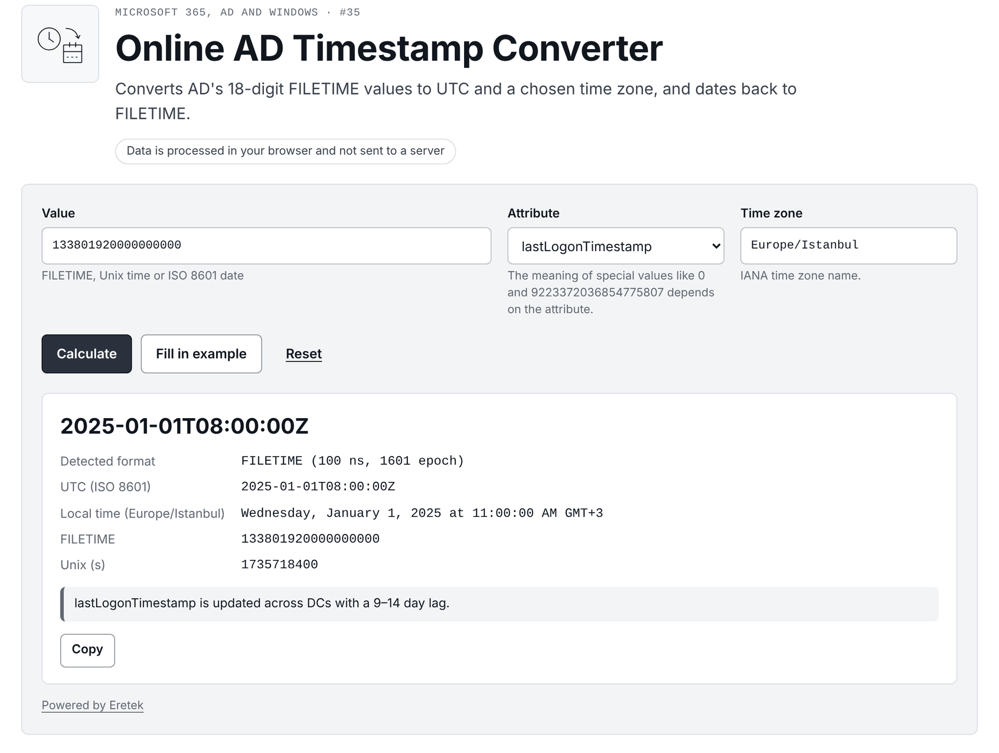

# AD Timestamp Converter

Convert Active Directory FILETIME values (lastLogonTimestamp, pwdLastSet, accountExpires) to UTC and local time; reverse from Unix and ISO dates; special values.

## Try it live

- [Türkçe](https://sistem.eretek.com/araclar/ad-zaman-damgasi-donusturucu)
- [English](https://sistem.eretek.com/en/tools/ad-timestamp-converter)
- [Deutsch](https://sistem.eretek.com/de/werkzeuge/ad-zeitstempel-konverter)



## What it does

Converts AD's 18-digit FILETIME values to UTC and a chosen time zone, and dates back to FILETIME.

Most AD date attributes count 100-nanosecond intervals since 1601-01-01 (FILETIME). These are 64-bit numbers, so ordinary JavaScript numbers lose the last digits. The tool uses BigInt and shows attribute-specific special meanings such as 0 or the maximum value.

## Where it helps

For stale account clean-up use lastLogonTimestamp with at least 14 days of uncertainty, e.g. 104 days for a 90-day threshold.

## How to use it

1. Paste the value: FILETIME (18 digits), Unix seconds/milliseconds or an ISO date (`2026-11-16T09:00:00Z`).
2. Choose which attribute it comes from; special values are interpreted accordingly. Enter the time zone as an IANA name (`Europe/Berlin`).

### Fields

| Field | Description |
|---|---|
| Value | FILETIME, Unix time or ISO 8601 date |
| Attribute | The meaning of special values like 0 and 9223372036854775807 depends on the attribute. |
| Time zone | IANA time zone name. |

## Example input

Press **Fill in example** in the tool to load this input.

| Input | Value |
|---|---|
| Value | `133801920000000000` |
| Attribute | `lastLogonTimestamp` |
| Time zone | `Europe/Istanbul` |

**Expected result:** 133801920000000000 → 2025-01-01T08:00:00Z, 11:00 in Istanbul; Unix 1735718400.

## Method and assumptions

FILETIME → Unix ms: (value − 116444736000000000) / 10000, computed with 64-bit BigInt. Unix (9–11 digits seconds, 12–14 digits milliseconds) and ISO dates are also accepted; an ISO date without a time zone is taken as browser local time with a warning.

Special values: for accountExpires 0 and 9223372036854775807 mean 'never'; for pwdLastSet 0 means 'must change password at next logon'.

## Limits and common mistakes

- Generalized Time values (`20261116090000.0Z`) such as whenCreated are not decoded in this version.

## Run it locally

The tool is plain HTML, CSS and JavaScript with no build step and no dependencies.

```bash
git clone https://github.com/eretek/ad-timestamp-converter.git
cd ad-timestamp-converter
node scripts/serve.js        # or: python3 -m http.server 8080
```

Open <http://127.0.0.1:8080/>. Add `?lang=tr` or `?lang=de` for Turkish or German; without it the page follows the browser language and falls back to English. You can also open `index.html` directly from disk.

Run the tests (Node.js 18 or later):

```bash
node test/run.js    # or: npm test
```

The tests run the tool's own fixtures and the worked examples in all three languages without a browser.

## How it works

All processing happens in your browser. The tool makes no network requests, uses no cookies or browser storage, and does not upload files you select.

No server-side component is needed. The version on the Eretek website renders the same page through a private WordPress plugin; that plugin only produces the page markup and is not part of this repository.

| Path | Purpose |
|---|---|
| `index.html` | Page shell |
| `src/app.js` | Builds the page in Turkish, English or German from `src/data.js` |
| `src/data.js` | Field definitions, examples and all texts in three languages |
| `src/core.js` | Shared runtime: validation, number formats, result rendering, CSV/ICS export |
| `src/tool.js` | The calculation or analysis for this tool |
| `docs/screenshot.png` | Screenshot used in this README |
| `src/tools.css`, `src/page.css` | Styles |
| `test/run.js`, `test/cases.json` | Headless tests |

## License and attribution

This tool is released under the [Eretek Website Attribution License](LICENSE). You may use, modify and redistribute it, including commercially. If you make it available on a website or web application, show a visible, clickable credit linking to https://eretek.com/ on every page where the tool is available, for example:

```html
<a href="https://eretek.com/">Powered by Eretek</a>
```

You may add `rel="nofollow"` to the link. Keep the copyright notice and license text in copies and redistributions.
